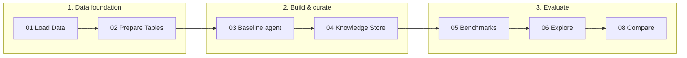

# Databricks Genie Agents Workshop — Manufacturing Quality Analytics (GMF 2-hour version)

> **GMF version.** This is the 2-hour version of the workshop for GMF. It keeps notebooks **00–06 and 08** and uses the shared **`containerunitycatalog`** catalog with one schema per participant. The full 4-hour version (metric views, Genie Code skills, security, monitoring, CI/CD, cleanup) is on `main`.

A hands-on workshop that teaches you to **build, curate, evaluate, and operate a production-ready Databricks Genie Agent** on manufacturing quality data — and to know when *not* to use one.

The core message: a Genie Agent is only as good as the **data foundation and curation** behind it. You'll build **two agents on the same data** and prove, with benchmarks, that curation is what earns trust:

- **[Baseline](https://learn.microsoft.com/en-us/azure/databricks/genie-agents/concepts#select-data)** — tables only (the "before")
- **[Knowledge Store](https://learn.microsoft.com/en-us/azure/databricks/genie-agents/tune-quality)** — measures, filters, fields, joins, synonyms, and example SQL (the "after", and your primary agent)

## Workshop flow



## What you will walk away with

- **A production-ready Genie agent** with a structured **Knowledge Store** (Notebook 04) — measures, joins, synonyms, and Q-to-SQL examples — instead of one brittle instructions blob.
- **Proof that curation matters** (Notebook 08) — the same hard questions run against the baseline and Knowledge Store agents, side by side.
- **A repeatable evaluation workflow** (Notebook 05) — push benchmarks, run them in the UI, review failures with knowledge snippets, and iterate.

## Prerequisites

See **`PREREQUISITES.md`** for the full checklist. In short: a Databricks workspace with **Unity Catalog** and **Genie** enabled, a **Pro/Serverless SQL warehouse**, and privileges to `CREATE TABLE`, `CREATE VOLUME`, and `CREATE FUNCTION` in your own schema in `containerunitycatalog`.

## Getting started

1. Import the **`notebooks/`** and **`templates/`** folders into your Databricks workspace so they sit side-by-side:

   ```
   /Workspace/Users/<your_email>/genie-agents-workshop/
     notebooks/        ← 8 notebooks (00–06, 08)
     templates/        ← Genie agent configuration (reference)
   ```

2. Open **`00_workshop_config`** and check your **catalog** and **schema**. The defaults are `containerunitycatalog` and a schema named after your login (e.g. `ashish.arun@…` → `ashish_arun`). If your schema has a different name, set `SCHEMA_OVERRIDE` in 00's first code cell (the Schema widget doesn't carry over to the other notebooks).

3. Run notebooks **01 → 06**, then **08**, in order. Every notebook reads your config
   automatically via `%run ./00_workshop_config`.

## Notebooks

| # | Notebook | What you will do |
|---|----------|-----------------|
| 00 | **Workshop Config** | Check your catalog and schema (GMF defaults), and preferences |
| 01 | **Load Data** | Create 7 manufacturing tables (plants, lines, operators, events, quality metrics, safety, feedback) |
| 02 | **Prepare Data** | Add table comments, create analytics functions |
| 03 | **Baseline Agent** | Create a tables-only agent — the "before" for comparison |
| 04 | **Knowledge Store** | Curate programmatically: measures, filters, fields, joins, synonyms, example SQL — the primary agent |
| 05 | **Benchmarks** | Push benchmark questions to both agents, run in the UI, fix failures with knowledge snippets and ground-truth updates |
| 06 | **Explore with Genie** | Ask questions in the Genie UI, verify with reference SQL |
| 08 | **Compare** | Run the same hard questions on the baseline and Knowledge Store agents |

## How the evaluation works

**Notebook 05** defines benchmark questions with ground-truth SQL and pushes them to both agents' **Benchmark** tabs:

```
  Define benchmark questions with ground-truth SQL
                        │
                        ▼
            Push to Genie Benchmarks tab
                        │
                        ▼
        ┌──▶ Run in UI / Review failures
        │               │
        │               ▼
        │   Accept knowledge snippets /
        │       Update ground truth
        │               │
        │               ▼
        │         All passing?
        │          │        │
        │         No       Yes
        └──────────┘        │
                            ▼
                    Benchmarks green
```

**Notebook 08** proves curation matters by running the same four hard questions against both agents:

```
            4 hard questions
                   │
                   ▼
   Run on Baseline and Knowledge Store
                   │
                   ▼
    Compare pass rates side by side
                   │
                   ▼
     Baseline struggles;
     Knowledge Store wins
```

The benchmark questions **teach patterns** (state joins, ratio calculations, shift
aggregation). The four comparison questions in notebook 08 are intentionally
**different** — Genie must generalize from the curation, not memorize answers.

## Repository structure

```
├── notebooks/          8 workshop notebooks (00–06, 08)
├── templates/          Genie agent configuration (reference)
│   └── manufacturing_genie_configured.json
├── WORKSHOP_PLAN.md    Facilitator plan + best-practices reference
├── PREREQUISITES.md    Attendee pre-work checklist
└── README.md
```

## Compute

All notebooks run on **Serverless** compute. Classic clusters with Unity Catalog access also work.

## Troubleshooting

| Symptom | Fix |
|---------|-----|
| Notebook 03 / 04 fails to create an agent | Check Genie entitlement, SQL warehouse availability, and API permissions. |
| "Schema … doesn't exist and you can't create it" in 01/02 | Your schema in `containerunitycatalog` is named differently from your login. Set `SCHEMA_OVERRIDE` in 00 to the schema you were given, then re-run 01. |
| Wrong catalog in Genie answers | Ensure notebook 00 has the same catalog/schema you used in 01–02. |
| Benchmarks in wrong UI tab | Notebook 05 pushes benchmarks inside `serialized_space.benchmarks` (the GA API), so they land in the Benchmarks tab. |

## License and data

Sample data is **synthetic** — generated for training and demos, not real
production or customer data.

## Credits

Adapted and extended from an earlier internal Databricks manufacturing Genie workshop. The Genie Agents modernization — terminology, audit fixes, the Knowledge Store notebook, and the agent comparison — was added on top.
